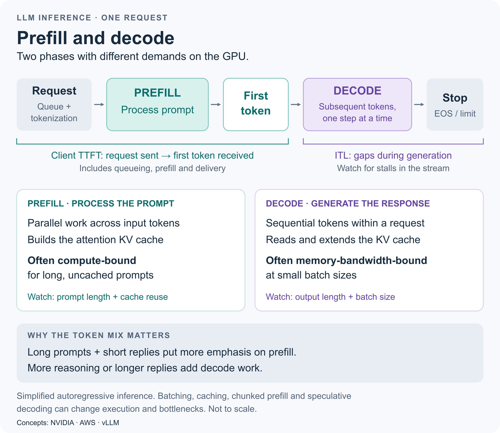
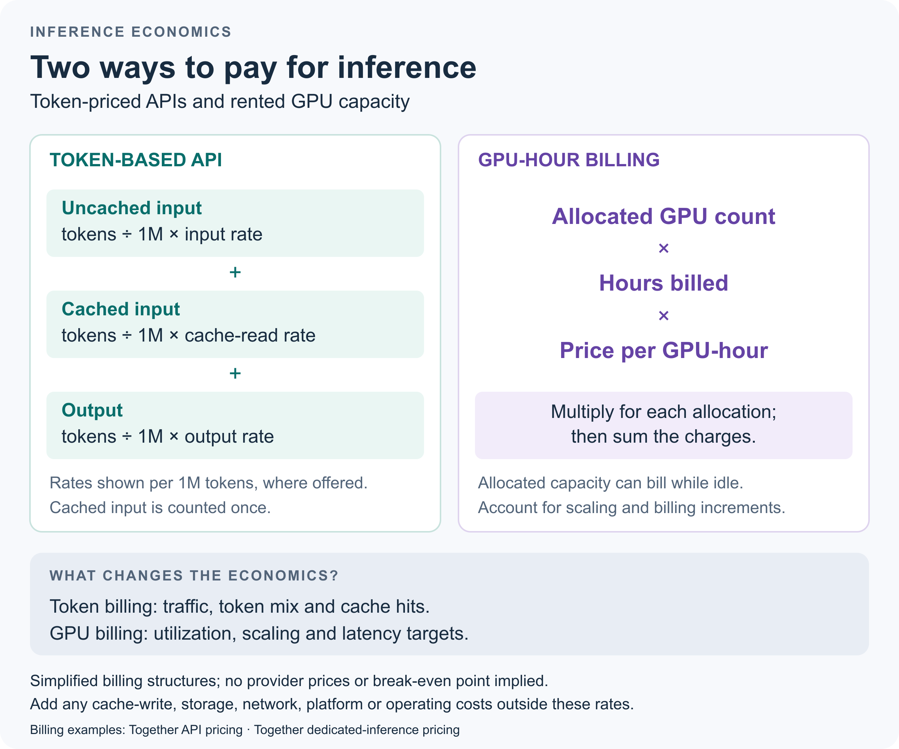

# From Closed to Open-Weight LLMs: Choosing the Inference Stack for Voice AI (Part 1)

**Balancing latency, cost, and control in a voice AI deployment**

*Part 1 of a series on voice AI and inference engineering. We’ll explore a migration to open-weight LLMs using a fictional bicycle-rental agent and illustrative numbers.*

Imagine calling a bicycle-rental shop: "Hi, I'd like to rent two bikes tomorrow morning." A voice AI agent asks when you'd like to pick them up. The exchange follows a familiar pipeline:

```text
Caller audio → STT → transcript → LLM → response text → TTS → speech
```

Suppose the pilot succeeds and the business deploys the agent across more shops. More calls mean a growing LLM bill, while the Saturday-morning rush brings longer pauses before some replies. The engineering team behind the rental agent now has a familiar problem: the pilot worked, and success has made it expensive. Looking at the costs and timings points to the LLM stage as a useful place to improve, keeping speech-to-text (STT) and text-to-speech (TTS) in place.

We'll follow that investigation from the existing API to the open-weight ecosystem, then use the agent's workload to test configurations, size the deployment, and estimate costs. The final step is deciding what must hold up when the conversation moves to the new model, including recovery when something goes wrong. The caller just wants a bike; naturally, we're going to discuss GPU utilization.

## When the growing bill starts the migration conversation

The first reason to look elsewhere is economic. Each new shop brings more conversations, and each conversation makes repeated LLM calls carrying instructions, history, and tool results. A token-priced API made the pilot easy to launch; the engineering team now wants to know whether the same service can become more economical as it grows.

Latency adds pressure to that conversation. Callers still expect a natural pace, and the longer pauses invite an occasional "Are you still there?" Faster service tiers from the current provider belong in the comparison. For example, OpenAI's [Fast mode](https://developers.openai.com/api/docs/guides/fast-mode), previously called Priority processing, offers faster processing at a per-token premium. Buying faster responses may help the experience while making the bill harder to explain.

That is a natural point to explore open weights. Could a different model, running on a configuration tuned for this agent, improve the balance? Access to weights brings choices about model revisions, quantization, reasoning settings, serving engines, and where inference runs. The appeal expands from cost to **latency, control, and flexibility**.

Those benefits can justify a migration even when it costs more. For now, though, the engineering team has a reason to investigate. Turning it into a business case will take a workload profile and some deployment tests.

## From open weights to an endpoint the agent can call

The obvious next thought is, "Could we host one of these models ourselves?" To answer it, the engineering team needs a map of the ecosystem. Model publishers release weights, inference projects build engines to run them, and hosting providers package those engines into services.

The **weights** are parameters learned during training. An open-weight release makes them available to run under its license, often through the publisher's repository on the [Hugging Face Hub](https://huggingface.co/docs/hub/models-the-hub). Families such as [Kimi](https://huggingface.co/moonshotai), [GLM](https://huggingface.co/zai-org), and [DeepSeek](https://huggingface.co/deepseek-ai) give us candidates to explore. For each release, I'd check the exact version, tokenizer, configuration, and [model card](https://huggingface.co/docs/hub/model-cards).

An **inference engine** loads those model files and generates tokens. Around it, the serving stack handles the API, request scheduling, scaling, and monitoring. The organization publishing the model and the provider running that stack can be different. Hugging Face's [deployment overview](https://huggingface.co/docs/inference-endpoints/about) describes these model, engine, and infrastructure layers.

So the engineering team can use open weights while keeping an API-based integration. How much of the machinery it operates depends on the deployment option:

- **Shared or serverless API:** call a provider's endpoint on shared infrastructure, usually paying per token.
- **Managed dedicated deployment:** reserve capacity while the provider operates the serving stack.
- **Self-managed deployment:** rent or own **bare metal GPU servers**, or rent [GPU virtual machines](https://docs.lambda.ai/on-demand-cloud/overview/), typically with SSH access to the host. The engineering team owns the serving software, scaling, monitoring, and upgrades.

The middle option is especially useful to understand. **Dedicated** describes the allocated capacity; **managed** describes who operates it. We can reserve GPUs for the rental workload and still have a provider operate its optimized serving stack. [Together](https://docs.together.ai/docs/dedicated-endpoints/overview), [Baseten](https://www.baseten.co/resources/guide/the-baseten-inference-stack), and [Hugging Face](https://huggingface.co/docs/inference-endpoints/about) offer different managed approaches, with different model, engine, hardware, and configuration support.

The latency case for dedicated capacity is control over resource contention, scheduling, and available headroom. Look for a more predictable p95/p99 under the same offered workload, alongside the median. Your own requests can still saturate reserved GPUs; the tail improvement has to show up in the measurements.

Once a provider looks promising, the trial is also a chance to meet the people behind the endpoint. I'd bring a reproducible workload and a slow trace or unexpected result, then see how the provider's engineers help investigate it. Model and quantization support, access to queueing and cache metrics, tuning controls, escalation coverage, and actual GPU availability all matter here. The working relationship becomes much easier to assess when there is a concrete problem to solve together. To make that trial useful, we first need to bring the agent's actual workload to the discussion.

## Profile the workload before choosing the configuration

We now have ways to try an open-weight model: a shared endpoint for an initial prototype, a managed dedicated deployment, or a stack we operate ourselves. Before choosing GPUs, let's put numbers on what the engineering team needs to serve. We'll carry this illustrative workload through the rest of the article.

Assume the shops handle **1,200 conversations per day across an eight-hour business window**. Each conversation makes **20 LLM requests**, averaging **8,000 input tokens and 200 generated tokens per request**, including reasoning. Those invocations cover spoken replies, classification, and follow-up work around tool calls. The prompt carries instructions, tool definitions, and conversation history; only part of the generated output becomes speech.

That gives us:

```text
Daily LLM requests = 1,200 conversations × 20 requests = 24,000
Average request rate = 24,000 ÷ (8 × 3,600 seconds) ≈ 0.83 requests/second
Input/output token ratio = 8,000 ÷ 200 = 40:1
```

The average hides the Saturday rush. For the example, assume the busiest two hours average **2.5 requests/second**, with shorter bursts inside that window. That accounts for 18,000 requests; the other 6,000 arrive across the remaining six hours. At 2.5 requests/second, the workload submits **20,000 input tokens/second** and generates **500 output tokens/second**. An output-token benchmark alone leaves most of that work undescribed.

These numbers give us a starting profile. The existing agent's traces should supply the actual distributions of input lengths, reasoning and final-answer lengths, reusable prefixes, and arrival rates. Concurrent phone calls do not all request inference at the same instant, and a late conversation turn can carry much more history than its opening request.

### Start with the caller's deadline

Traffic volume tells us how much work arrives. A trace through the existing proprietary API tells the engineering team how quickly the replacement needs to respond. For this example, set a target: **hand the first final-answer text to TTS within 1,500 ms of the caller's last sound for at least 99% of spoken replies**. That clock includes the time spent deciding that their turn has ended. Here is one illustrative turn:

| Time since the caller stopped speaking | Event |
| --- | --- |
| 0 ms | Caller finishes the request. |
| 300 ms | The endpointing policy accepts the pause as the end of the caller's turn. |
| 460 ms | After another 160 ms for transcript delivery and application processing, the LLM request is sent. |
| 960 ms | The first response-text token arrives; the application keeps buffering. |
| 1,060 ms | The application sends the first final-answer text segment to TTS. |
| 1,210 ms | The spoken reply becomes audible. |

Client **time to first token (TTFT) is 500 ms**, and the caller waits **about 1.2 seconds** for speech. The first-final-answer handoff to TTS happens 600 ms after the LLM request. TTFT is the largest single stage, but endpointing and request preparation together take another 460 ms. Collecting the first text segment takes 100 ms, followed by 150 ms until speech becomes audible.

The endpointing delay belongs in that budget even though we are keeping STT in place. Silence thresholds and turn-detection policies affect when the application can act; [Deepgram's endpointing documentation](https://developers.deepgram.com/docs/endpointing) explains one implementation. Our 300 ms is an example setting. An actual trace should capture any overlapping work rather than adding it twice.

That gives the LLM migration a clear target without losing sight of the whole pause. Recording the TTS handoff and first audible reply shows whether an inference improvement reaches the caller. These are application timestamps the team can gather while the current proprietary API is still in use.

For each trace, keep the model, service tier, prompt length, cache status where available, and response length alongside the timings. A single latency number means much more when we know which part of the turn it measures and what work the model was doing.

In this turn, endpointing and preparation use 460 ms of the 1,500 ms budget. Allowing another 100 ms to collect the first text segment leaves **940 ms for the LLM's first response token**. Other request types need their own deadlines. Now the candidate models have both a workload to serve and a latency objective to meet.

### Try candidate models on the same conversations

With a baseline in hand, the engineering team can prototype the open-weight candidates using representative scenarios and tool calls. Check basic conversational behavior first, then profile each viable release with its own tokenizer, chat template, and reasoning settings. A prompt change can alter both input length and generated reasoning, so update the profile as the prototype evolves.

The infrastructure comparisons below assume we can adapt the prompts and tool integration to match the current agent's task success and conversational behavior. Establishing that match is a prerequisite for switching models. **Part 2** covers the prompt migration and evaluation needed to demonstrate it; a lower bill or a faster endpoint cannot substitute for that work.

Cache behavior belongs in that comparison too. Record matching token prefixes and actual cache hits, including cold starts and replica changes. The existing API's cached-input discount and the new engine's ability to reuse KV state affect different sides of the migration calculation.

### What prefill and decode imply for this workload

Those token counts become more useful once we connect them to what happens on the GPU. A long conversation history followed by a short question creates a different balance of work from a brief prompt followed by extensive reasoning. An autoregressive Transformer processes that work in two main phases:

- **Prefill** processes prompt tokens in parallel and builds the attention **key-value (KV) cache**. Its result can produce the first output token.
- **Decode** generates subsequent tokens, reading and extending that cache. In the basic loop, each sequence advances one token per step.

[NVIDIA's inference guide](https://developer.nvidia.com/blog/mastering-llm-techniques-inference-optimization/) explains the phases and their resource demands.



*Prefill and decode place different demands on the same response budget.*

The useful hardware concept is **arithmetic intensity**: floating-point operations per byte moved from memory. Prefill can reuse weights across many prompt tokens. Small-batch decode uses those weights for fewer tokens per step, often making GPU memory bandwidth a limit. Larger batches improve weight reuse, while each sequence's KV cache still needs attention. The [roofline](https://jax-ml.github.io/scaling-book/roofline/) and [Transformer inference](https://jax-ml.github.io/scaling-book/inference/) chapters of *How To Scale Your Model* develop the calculations.

For long prompts and short generated responses, **uncached prefill and its queueing deserve early attention**. They can dominate the path to the first token and constrain capacity. That conclusion depends on the actual cache hits and generated length: extensive reasoning can turn a short spoken reply into a long decode.

A practical first experiment is **prefix caching**. If 4,000 of an 8,000-token prompt match a cached prefix, the engine can reuse that prefix's KV state and prefill the remaining suffix. It still reads cached context and generates the reply. [vLLM's prefix-caching documentation](https://docs.vllm.ai/en/latest/features/automatic_prefix_caching/) explains both the reuse and its limits.

Keep stable instructions and tool definitions consistent, and measure what happens when traffic spreads across replicas. With local caches, a request benefits only when the selected worker has the reusable state. Cache-aware routing balances that reuse against worker load; pinning everything to the warmest worker can simply move the delay into its queue. [NVIDIA Dynamo's routing design](https://docs.nvidia.com/dynamo/latest/knowledge-base/concepts/system-architecture/kv-aware-routing) makes that tradeoff explicit.

Measure cold and warm behavior, cache evictions, and new-replica traffic. Then examine scheduling: [vLLM's tuning guide](https://docs.vllm.ai/en/latest/configuration/optimization/) shows how chunked prefill can share batches with decode work, affecting both TTFT and inter-token latency (ITL). Quantization, attention kernels, speculative decoding, and prefill/decode disaggregation warrant their own treatment; the goal here is to identify which experiments the workload justifies.

### Turn the profile into deployment trials

With the conversation profile and its prefill/decode balance in view, we can put a more useful set of trials in front of a provider. The experiment matrix is **model and revision × GPU type × GPUs per replica × replica count × inference configuration**. Record the engine version, quantization, parallelism, batching, caching, and reasoning settings. My future self would appreciate a better deployment record than "the fast one from Tuesday."

I'll use **B200:4** to mean one replica spread across four B200 GPUs. For a model that fits and supports both arrangements, **one B200:8 replica** and **two B200:4 replicas** are different experiments. They have the same GPU count, but different opportunities for concurrency, cache reuse, and communication. [vLLM's parallelism guide](https://docs.vllm.ai/en/latest/serving/parallelism_scaling/) covers distributing models across GPUs.

## Find the capacity that meets the deadline

A few promising configurations give us something to take into the Saturday rush from our story. This is where calls from several shops overlap, with short exchanges mixed into longer conversations. The next test is whether the configurations can keep up while callers still get timely replies.

To locate the **saturation knee**, drive the serving path with **open-loop arrivals**: schedule requests at a chosen rate independently of when earlier requests finish. Increase that offered rate in sustained steps and replay realistic bursts. A fixed pool of clients that waits for replies before sending more work slows its own arrivals as the server slows, potentially hiding overload. [Grafana's load-testing guide](https://grafana.com/docs/k6/latest/using-k6/scenarios/concepts/open-vs-closed/) explains this distinction.

Check that the load generator actually delivers the scheduled arrivals. Report offered, sent, completed, failed, and late requests, including generator lag or dropped arrivals. vLLM's [serving benchmark](https://docs.vllm.ai/en/latest/cli/bench/serve/) supports request-rate and burstiness controls; a client concurrency cap can prevent it from reaching the requested rate.

Keep a separate conversation replay for turn dependencies, pauses, and tool calls. Open-loop serving tests expose capacity limits; conversation tests show how those limits affect the application.

The useful headline is **goodput: completed requests per second that satisfy the chosen latency objectives**. [DistServe's authors](https://haoailab.com/blogs/distserve/) explain why this differs from raw throughput. Choose objectives by request type; for spoken replies, include the first-final-answer handoff deadline and any required completion or streaming-gap limits.

Report goodput together with:

- **Input-token throughput:** submitted and completed-request input tokens per second, distinguishing cached prefixes from tokens that require new prefill work.
- **Output-token throughput:** reasoning and final-answer tokens, with their lengths.
- **Client TTFT, ITL, and request latency:** p50, p95, and p99, alongside the application timestamps from the baseline trace.
- **Queue depth, queueing time, GPU utilization, and KV-cache occupancy and hit rates.**
- **Deadline misses, errors, and timeouts**, including requests absent from successful-response percentiles.

Streaming chunks can contain multiple tokens, so chunk-arrival gaps are not necessarily per-token timings. Record each metric's boundaries and aggregation.

At this stage, we are testing the replacement serving stack. Where engine metrics are exposed, we can connect them to the application timestamps gathered earlier; [vLLM's metrics documentation](https://docs.vllm.ai/en/latest/usage/metrics/) describes those measurements. An engine timing may exclude network transit or upstream queueing, so compare matched request traces to understand the gap. For models that expose reasoning output, keep its arrival separate from the final-answer text handed to TTS.

The knee appears when extra offered traffic produces little additional useful work while queues and tail latency rise. [Google's SRE guidance](https://sre.google/sre-book/handling-overload/) also explains why request counts alone can hide differences in work per request. Run the test across the token distributions and cache states you expect in production.

Now the profile and the load test can answer the sizing question. Suppose a candidate fits on **B200:4**, and the tests support an operating rate of **two requests/second per replica** while meeting the latency objectives, with headroom below the knee. That capacity figure is an assumption for this worked example.

For the busy window, the first estimate is:

```text
Busy-window replicas = round up(2.5 requests/second ÷ 2 requests/second per replica)
                     = 2 replicas
```

Repeat the test against the full two-replica deployment, including the short bursts, cache distribution, and routing behavior. This confirms whether the fleet delivers the expected capacity. Keep a latency comparison beside the replica count, so the cost discussion has a performance benefit to weigh. For spoken-response requests within the same offered workload, suppose our fictional results look like this. To isolate the inference difference, hold the 460 ms before LLM dispatch and the 100 ms from first response token to TTS handoff constant:

| Serving path | Client TTFT p50 | Client TTFT p99 | TTS-handoff p99 | 1,500 ms target at p99 |
| --- | --- | --- | --- | --- |
| Existing proprietary API | 500 ms | 1,400 ms | 1,960 ms | Misses |
| Candidate deployment: two B200:4 replicas | 300 ms | 650 ms | 1,210 ms | Meets |

TTFT starts at request dispatch; the handoff clock starts at the caller's last sound. With those fixed non-LLM delays, handoff time is TTFT plus 560 ms. **The candidate meets the 1,500 ms handoff target at p99; the existing API misses it.** That is the benefit we can weigh against the deployment cost.

These remain illustrative values. In the earlier single-turn example, replacing 500 ms with 300 ms would bring audible speech from 1,210 ms to 1,010 ms. In production, calculate handoff percentiles from complete traces: variable endpointing, buffering, and inference delays cannot be combined by adding their separate percentiles.

With capacity and latency together, the engineering team can turn the replica count into a daily schedule.

## Schedule capacity around the shops

The trials give us a reason to run two replicas during the rush. They also show that one can cover the quieter hours. For an initial budget, allow **one B200:4 replica for eight hours, plus a second for the two-hour peak**: ten replica-hours, or **40 GPU-hours per day**. We can now price a specific operating plan.

Making that plan work involves two schedules: when replicas are available, and how requests share their GPUs.

For **replica availability**, I would start from the stores' combined opening hours and expected traffic. Bring the initial capacity up before the first calls, verify that the model is ready, and warm reusable prefixes where useful. Add capacity ahead of predictable peaks, then drain active work before scaling down. [Hugging Face's autoscaling guide](https://huggingface.co/docs/inference-endpoints/guides/autoscaling) describes both daily schedules and cold-start behavior. The first caller of the day should not have to wait through the model's startup routine.

During the day, compare actual arrivals with the profile used to size the fleet. The aim is enough work per replica to use it efficiently, with headroom before queueing pushes replies past their deadlines. Watch queueing, tail latency, and KV-cache pressure alongside GPU utilization; a busy GPU can still be making callers wait. Scale-up decisions also need to account for how long a new replica takes to become useful. Shops in different time zones may need a longer combined window than the eight hours in our example.

For **request scheduling**, continuous batching lets the engine admit new work at iteration boundaries as capacity becomes available. Larger running batches can improve aggregate throughput while making each generation step take longer. Prefill chunks sharing those steps can also slow sequences already decoding. Tune the active-sequence limit and prefill token budget against both TTFT and ITL. The [inference-engine discussion in *How To Scale Your Model*](https://jax-ml.github.io/scaling-book/inference/) covers continuous batching; the [vLLM tuning guide](https://docs.vllm.ai/en/latest/configuration/optimization/) explains the prefill/decode scheduling tradeoff.

Cache-aware routing belongs in that plan too, balancing reusable state against each replica's current load. These choices connect utilization to something the rental business can use: requests completed on time per billed GPU-hour. The eight- and two-hour allowances are our first estimate; add any billed time needed to prepare and drain capacity. That gives us the hours to put beside the provider's price.

## Put a price on the capacity the agent actually needs

We started this investigation because the LLM bill was growing. Now we know the daily conversation volume, requests per conversation, token profile, and a candidate replica schedule. The comparison can finally use the deployment the engineering team would operate.

Model openness and billing remain separate choices. Both proprietary and open-weight models can be offered through token-priced APIs. Dedicated capacity charges for an allocation over time. [Together's pricing](https://www.together.ai/pricing) illustrates both structures.



*Count each input token once, at its applicable cached or uncached rate. Sum GPU charges across all billed allocations.*

### Compare the existing API bill with the replica plan

Our 20 requests per conversation add up to **160,000 input tokens and 4,000 output tokens**. Assume half the input qualifies for cached-input pricing on the existing API. Its token rates below are illustrative; the Together rates we use for the alternatives are published prices, checked on November 11, 2026.

| API usage per conversation | Assumed price per million tokens | Cost |
| --- | --- | --- |
| 80,000 uncached input tokens | $2.00 | $0.160 |
| 80,000 cached input tokens | $0.50 | $0.040 |
| 4,000 output tokens, including reasoning | $8.00 | $0.032 |
| **Total LLM cost** | | **$0.232** |

At **1,200 conversations/day**, that is **$278.40/day** for LLM usage. Add illustrative per-conversation costs of **$0.016 for STT, $0.040 for TTS, and $0.020 for telephony**, based on the audio usage of a short rental call. The total becomes $0.308 per conversation, or **$369.60/day**, with the LLM contributing about **75%**. Audio costs follow actual call duration and spoken output, independently of the LLM invocation count.

For the candidate deployment, Together lists **$8.99 per B200 GPU-hour for on-demand dedicated inference** in its [pricing table](https://www.together.ai/pricing). That is the managed inference rate; GPU-cluster rental is a separate offering. A **B200:4** replica therefore costs **$35.96/hour**.

Apply that rate to the schedule:

```text
Daily replica-hours = 1 replica × 8 hours + 1 replica × 2 hours = 10
Daily GPU-hours = 10 replica-hours × 4 GPUs/replica = 40
Daily dedicated compute = 40 GPU-hours × $8.99/GPU-hour = $359.60
Current API LLM cost = 1,200 conversations × $0.232 = $278.40/day
```

Dedicated compute costs **$81.20 more per day than the existing API**, before additional operating work. Now there is a concrete tradeoff: our fictional candidate brings the TTS-handoff p99 from 1,960 ms to 1,210 ms, meeting the 1,500 ms target. The engineering team can price that deadline improvement while checking whether another serving option can deliver it for less.

### Follow the utilization through the day

The schedule offers **72,000 requests/day of tested operating capacity**: ten replica-hours at two requests/second. We send 24,000 requests, so we use about **33%** of that capacity. During the two-hour rush, the two replicas run at **62.5%**; during the other six hours, the single replica runs at about **14%**.

Those percentages describe how much of the example's assumed serving capacity the workload uses. They are separate from hardware GPU-utilization readings. The quiet hours explain much of the cost gap: one replica is the minimum deployment, but it is still more capacity than those hours need.

Against the existing proprietary API's average **$0.0116/request**, the fixed schedule breaks even on compute at about **43% capacity utilization**, or 1,550 conversations/day. Added operating costs raise that threshold. This is our first comparison; a cheaper token-priced endpoint for the new model would move the break-even too.

### Let the traffic shape suggest another plan

The peak's 62.5% utilization is above compute break-even against the proprietary API, while the quiet hours fall well below it. That suggests a hybrid: **two B200:4 replicas for the two-hour rush, with the existing API serving the other six hours**.

```text
Peak dedicated compute = 2 replicas × 4 GPUs/replica × 2 hours × $8.99/GPU-hour = $143.84
Off-peak API usage = 6,000 requests × $0.0116 = $69.60
Hybrid LLM serving cost = $143.84 + $69.60 = $213.44/day
```

That saves **$64.96/day, or about 23% of LLM spend**, before added operations. It also puts the candidate's latency benefit in the busiest window. This is a useful exercise for planning as the business grows, but I would start production with one primary model and serving path. A hybrid spanning different models means maintaining separate prompts, behavioral evaluations, and rollout paths, alongside conversation state and routing. That work can outweigh the savings.

We should also return to the first deployment option we considered: **serverless open weights**. For a priced candidate, Together lists [GLM-5.2](https://www.together.ai/models/glm-52) at **$1.40 per million uncached input tokens, $0.26 for cached input, and $4.40 for output**. Applying the same illustrative daily profile—96 million uncached input tokens, 96 million cached input tokens, and 4.8 million output tokens—gives **$180.48/day**.

That rate earns the serverless endpoint a trial. Benchmark its behavior, final-answer latency, rate limits, and actual token usage separately; the earlier latency table belongs to the fictional dedicated deployment. A different tokenizer, reasoning length, or cache hit rate changes the bill.

Now the relevant cost comparison changes. That serverless profile costs **$0.00752/request**, putting dedicated compute break-even at about **66% capacity utilization**:

```text
Compute break-even vs. serverless = $359.60 ÷ (72,000 requests × $0.00752)
                                 ≈ 66% of the scheduled operating capacity
```

Both the full schedule's 33% utilization and the peak's 62.5% fall below that threshold. **At this load, dedicated capacity is a latency or control purchase; it does not save money against all-serverless.** Its value depends on meeting a requirement that the serverless endpoint cannot meet. With this traffic shape, growth would also require another peak replica before the all-day schedule reached 66%, so the replica count and cost must be recomputed as demand grows.

There is one more useful pricing scenario: **dedicated at the peak, serverless off-peak, using the same model**. Suppose the same GLM-5.2 release also qualifies for our assumed B200:4 configuration. The two-hour dedicated bill stays $143.84; the other 6,000 requests cost $45.12 on serverless. Together, that is **$188.96/day—$8.48 above all-serverless**, before extra operations.

If the model revision and prompt/response handling match, those two endpoints can share one prompt path. That reduces the maintenance burden, although both serving stacks still need regression tests, cache checks, and reliable routing. We would also need to validate that model's fit and latency on the dedicated configuration; the earlier fictional timings do not establish them.

The direct serving-cost comparison now looks like this, using all-serverless as the cost benchmark:

| Route | Daily LLM serving cost | Extra cost versus all-serverless |
| --- | --- | --- |
| Existing proprietary API | $278.40 | $97.92 |
| Dedicated across business hours | $359.60 | $179.12 |
| Dedicated at the peak, existing API off-peak | $213.44 | $32.96 |
| Serverless GLM-5.2 at the assumed token profile | $180.48 | Baseline |
| Dedicated at the peak, serverless off-peak: same-model scenario | $188.96 | $8.48 |

Adding the same **$91.20/day for STT, TTS, and telephony** preserves that ranking. All-serverless comes to **$271.68/day**, about **26% below the current $369.60 total**, before additional operating costs. The same-model peak hybrid comes to $280.16/day. The workload has stayed the same; changing how we serve it changes the result.

### Price the work of operating each route

The inference bill is only part of this decision. Each route needs an estimate of the **additional engineering work** it creates: deployment maintenance, monitoring, on-call coverage, provider coordination, and recovery testing. Use expected hours and the team's fully loaded hourly cost, then spread recurring work over the actual operating days. Budget the one-time migration separately, or amortize it over the period used for the comparison.

Once the serverless candidate qualifies, use it as the baseline for the extra work of running dedicated or hybrid capacity. For sensitivity, **$50/day of operations beyond all-serverless would raise the fixed dedicated schedule's break-even, including operations, from 66% to about 76% utilization**. The same-model peak hybrid already carries an $8.48/day serving premium; routing and deployment work add to it. Budget that premium against a measured deadline or control benefit, then reprice whenever the replica plan changes.

Together's [dedicated-inference billing](https://docs.together.ai/docs/dedicated-endpoints/pricing) charges for ready replicas and stops compute billing when they scale down; provisioning and cold-start time are not billed. Ready time spent warming caches or waiting for calls still belongs in the budget. Include hedged and fallback traffic, plus any extra billed preparation or drain time; a reservation or minimum commitment needs its own calculation.

That is the tension behind the spreadsheet: **latency needs headroom; attractive GPU economics need utilization**. An idle GPU is still quite good at generating invoices. The useful outcome is a serving plan whose price, response times, and operating demands the engineering team can defend.

## Carry the serving candidate into the migration

At this point, the engineering team has an infrastructure case, conditional on the prompt-performance match introduced earlier. **Part 2** covers the work needed to establish that match and finish the migration: prompt structure, reasoning leakage, conversation state, tool actions, and behavioral evaluation.

As those pieces change, replay the same representative conversations against the current and proposed paths. Compare task completion and tool correctness alongside response timing and cost, then repeat the capacity tests with the final prompts and reasoning settings. A prompt that improves behavior can also lengthen the workload used to size the fleet.

Those results establish whether to proceed with a gradual rollout. Before the first live calls move across, the engineering team also needs a tested recovery path.

## Keep a route back when the new deployment cannot serve

A successful evaluation describes the calls the deployment can handle. Recovery planning covers the morning when demand exceeds the forecast, a new replica is slow to start, or the preferred endpoint becomes unavailable.

**The proprietary API already serving the agent is a natural first fallback candidate.** It has an established prompt and behavior path. Preserve that path, and test switching into it with the current conversation state, tool-call handling, response budget, and available rate limits. Its existing use gives us a baseline; failover is still a new behavior to validate.

Another open-weight provider can add capacity, a different cost profile, or a recovery option. **GPU availability can justify it on its own:** a provider may list the hardware but be unable to allocate it when the rental business needs it. Confirm capacity, model configuration, health signals, and routing ownership for every route.

### Retries spend the same conversational deadline

For the caller, provider switching happens inside the same pause. If a turn has a 1,500 ms budget from the end of the caller's speech to handing final-answer text to TTS, and 1,200 ms have already elapsed, recovery has **300 ms left**, including detection and routing overhead. At the fallback's illustrative 500 ms TTFT, a fresh sequential request cannot fit, even before collecting text for TTS. A faster-than-median response is possible, but it is a poor recovery plan to depend on one.

That means designing the response to a slow turn before the budget is almost gone. **Hedged requests** start a second inference request while the first is still pending, early enough to leave time for the fallback's latency distribution. Select one usable response before committing speech or tool actions, cancel the other request where possible, and ignore its late output. Bound and budget the extra load. The [gRPC hedging guide](https://grpc.io/docs/guides/request-hedging/) explains the general pattern and its shared deadline.

Using the fallback's 500 ms TTFT, the latest zero-overhead trigger is **1,500 − 460 − 500 − 100 = 440 ms after initial dispatch**. Start earlier to leave room for routing overhead, and validate the policy against the latency distribution. That calculation uses the median; the fallback's 1,400 ms p99 cannot meet this deadline on its own, even if launched with the original request.

A **brief spoken filler**, such as pre-generated audio saying "Let me check that," is another option when the answer needs longer. It can acknowledge the pause promptly while inference continues. Track that first audio separately from the useful answer: the filler does not satisfy the original final-answer deadline. Keep a limit on how long the caller waits for the answer or a handoff.

That budget also depends on what the agent has already done:

- **Speech has started:** restarting generation can repeat or contradict words already sent to TTS. Decide whether to continue, interrupt, or recover with an explicit conversational response.
- **A tool action may have happened:** a rental reservation must not be submitted twice just because the inference response was lost. Preserve action state and use idempotency where the tool supports it.
- **No useful time remains:** choose the tested timeout or handoff behavior instead of piling retries onto an overloaded service.

Amazon's discussion of [timeouts, retries, and backoff](https://aws.amazon.com/builders-library/timeouts-retries-and-backoff-with-jitter/) covers retry amplification and side-effect handling. In a voice agent, those controls have to fit the conversation as well as the infrastructure.

## Bring the decision back to the rental business

The growing bill started the investigation. Exploring open weights gave the engineering team more options; profiling and testing turned those options into a replica plan, and the schedule gave the cost estimate something concrete to price.

**For this rental agent, I would start with serverless open weights.** Use it to establish that adapted prompts can match the existing agent's quality, then test the 1,500 ms handoff target, goodput, and recovery behavior. If it passes, keep that simpler serving path: it is the cheapest option in our example and requires no replica schedule to operate.

**Choose managed dedicated capacity when testing shows that serverless cannot meet a critical latency, reliability, or control requirement, and the dedicated deployment can.** Here, dedicated is a purchase of that capability, not a saving against serverless. A same-model hybrid could make sense for a requirement confined to peak hours, provided the benefit justifies maintaining the extra route.

As sustained load grows, dedicated capacity can become cheaper. Revisit the comparison against the best viable serverless option, including engineering time and every additional replica. The recommendation should follow that crossover when it happens; a bigger traffic number alone does not establish it.

That establishes the infrastructure case. Part 2 follows the conversation itself. The server can answer on time and still reserve the wrong bicycle.

*This article reflects my own ideas, experience, and perspective. I used AI tools to help with writing and editing—the part that usually keeps my articles in the “I’ll publish this someday” folder.*
